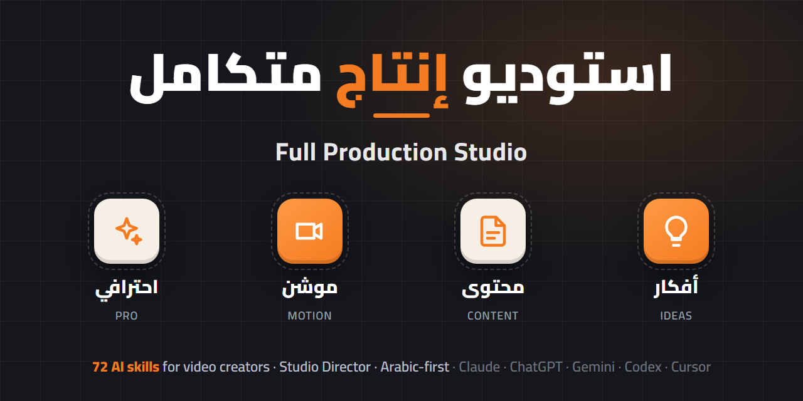

<div align="center">

[English](README.md) · **العربية**



# 🎬 استوديو إنتاج متكامل
### Full Production Studio

### [🌐 تصفّح كل السكيلز ←](https://alfaris.github.io/full-production-studio/)

[](https://github.com/alfaris/full-production-studio/releases/latest)
[](LICENSE)
[](CONTRIBUTING.md)

</div>

<div dir="rtl">

72 سكيل مفتوحة المصدر لصنّاع المحتوى والفيديو، بتغطي كل مرحلة من أول فكرة لحد التصدير النهائي.
فيها **مخرج** بيدير المشروع كله، وأول سكيلز **معمولة للعربي من الأساس** لصنّاع المحتوى العرب.
بتشتغل على: Claude Code، Claude.ai، Codex، Cursor، Gemini CLI، ChatGPT، وأي AI بيقرا ملفات `SKILL.md`.

---

## فيها إيه؟

لو طلبت من الـAI سكريبت أو موشن جرافيك من غير توجيه، النتيجة غالبًا بتطلع تقليدية ومملة. السكيلز دي بتدّيله اللي ناقصه: معادلات الهوك، وبناء السكريبت اللي يخلّي المشاهد يكمّل، والذوق في التوقيت والـEasing، والشغل على Remotion، وإيقاع المونتاج، وطريقة التصدير.

| | القسم | بيعمل إيه |
|---|---|---|
| 💡 | **أفكار** | بحث، استراتيجية، تحليل منافسين، زوايا جديدة |
| 📄 | **محتوى** | سكريبتات، هوكات، عناوين، صوتك الخاص، كتابة لكل منصة |
| 🎥 | **موشن** | موشن جرافيك بالكود، Remotion، صوت، محاكاة |
| ✨ | **احترافي** | مونتاج، كابشنز، تلوين، Reframe، تقطيع كليبات |

مش لازم تكون مبرمج. اختار طريقة التركيب اللي تناسب الـAI اللي بتستخدمه.

---

## 🎬 ابدأ من هنا: المخرج

72 سكيل رقم كبير، ومش محتاج تحفظ ولا واحدة منهم. ركّب الاستوديو وقول للـAI:

> «استخدم studio-director، واعملي ريل ٤٥ ثانية عن ___»

سكيل [`studio-director`](skills/studio-director/SKILL.md) بيدير المشروع زي أي إنتاج حقيقي: **فكرة ← سكريبت ← توزيع المشاهد ← موشن ← مونتاج ← كابشنز ← تصدير**. في كل مرحلة بيختار السكيل المناسبة، ويراجع النتيجة على معايير جودة، وياخد منك قرار واحد قبل ما يكمّل.

## 🌍 سكيلز معمولة للعربي

أول سكيلز مفتوحة المصدر **معمولة لصنّاع المحتوى العرب** من الأساس، مش مترجمة. بتفهم اللهجات (مصري، خليجي، شامي)، والكتابة من اليمين للشمال، وبتطلّع كابشن عربي من غير ما الحروف تتقطّع، وموشن للنص العربي، وسيو يوتيوب بالعربي.

| السكيل | بتحل إيه |
|---|---|
| [`arabic-voice`](skills/arabic-voice/SKILL.md) | بتحوّل الكلام الرسمي اللي شكله AI للهجتك الحقيقية |
| [`arabic-hooks`](skills/arabic-hooks/SKILL.md) | 12 معادلة هوك بأمثلة مصري وخليجي |
| [`arabic-script`](skills/arabic-script/SKILL.md) | سكريبت يوتيوب كامل متظبط على سرعة الكلام العربي |
| [`arabic-shorts`](skills/arabic-shorts/SKILL.md) | ريلز وتيك توك وشورتس في رد واحد، والنص في الأماكن الآمنة على الشاشة |
| [`arabic-titles-thumbnails`](skills/arabic-titles-thumbnails/SKILL.md) | العنوان ونص الثمبنيل مع بعض، ومكان النص صح للعربي، وخطوط عربية |
| [`arabic-market-research`](skills/arabic-market-research/SKILL.md) | إيه الناقص في المحتوى العربي، والمنافسين، ومواسم زي رمضان |
| [`arabic-youtube-seo`](skills/arabic-youtube-seo/SKILL.md) | كلمات مفتاحية بكل اللهجات، وطرق الكتابة المختلفة، والـchapters والتاجات |
| [`arabic-transcript-cleanup`](skills/arabic-transcript-cleanup/SKILL.md) | بتصلّح غلطات Whisper في العربي، وبتعلّم على الحشو عشان يتقص |
| [`arabic-captions`](skills/arabic-captions/SKILL.md) | كابشنز الحروف فيها متوصلة، وعلامات الترقيم في مكانها، وتلوين كلمة كلمة |
| [`arabic-motion-typography`](skills/arabic-motion-typography/SKILL.md) | تحريك النص العربي في Remotion و GSAP من غير ما الحروف تتقطّع |

## 📦 باقات جاهزة

مش عايز الـ72 كلهم؟ ركّب باقة:

</div>

```bash
# 🎬 المخرج: سكيل واحدة بتشغّل أي سكيلز تانية متركّبة عندك
npx skills add alfaris/full-production-studio --skill studio-director

# 🌍 صانع محتوى عربي
npx skills add alfaris/full-production-studio --skill studio-director --skill arabic-voice --skill arabic-hooks --skill arabic-script --skill arabic-shorts --skill arabic-titles-thumbnails --skill arabic-captions --skill arabic-youtube-seo

# ▶️ يوتيوبر
npx skills add alfaris/full-production-studio --skill studio-director --skill yt-plan --skill yt-script --skill yt-package --skill yt-retention --skill yt-seo --skill yt-chapters --skill yt-edit

# 📱 ريلز / تيك توك / شورتس
npx skills add alfaris/full-production-studio --skill studio-director --skill short-form-video --skill yt-shorts --skill hook-and-headline-writing --skill video-caption-creation --skill reframe-social

# 🎥 موشن ديزاينر
npx skills add alfaris/full-production-studio --skill studio-director --skill motion-design --skill remotion-motion-graphics --skill motion-design-html --skill review-loop --skill sound-design --skill arabic-motion-typography

# ✂️ مونتير: بيتعلّم طريقتك إنت في المونتاج لكل عميل (Claude Code)
npx skills add alfaris/full-production-studio --skill studio-director --skill editor-apprentice --skill arabic-transcript-cleanup --skill cutting-rhythm --skill filler-removal --skill captions --skill audio-edit --skill color-grade
```

<div dir="rtl">

---

## ⚡ التركيب

### 1) أي agent (Claude Code / Codex / Cursor / Gemini CLI / Copilot …) بأمر واحد
بيستخدم أداة [`skills`](https://github.com/vercel-labs/skills) المفتوحة، وهي بتعرف لوحدها إيه الـagents المتسطّبة عندك:

</div>

```bash
npx skills add alfaris/full-production-studio
```

<div dir="rtl">

لو عايز سكيلز معيّنة بس:

</div>

```bash
npx skills add alfaris/full-production-studio --skill yt-script --skill motion-design
```

<div dir="rtl">

### 2) كـplugin على Claude Code

</div>

```bash
/plugin marketplace add alfaris/full-production-studio
/plugin install full-production-studio@full-production-studio
```

<div dir="rtl">

### 3) سكريبت التركيب (بينسخ السكيلز في فولدرات الـagents عندك)

</div>

```bash
git clone https://github.com/alfaris/full-production-studio && cd full-production-studio
./scripts/install.sh            # ماك / لينكس / Git Bash: كل الـagents اللي عندك
./scripts/install.sh claude     # Claude Code بس  (~/.claude/skills)
```
```powershell
.\scripts\install.ps1           # ويندوز PowerShell
.\scripts\install.ps1 -Agent codex
```

<div dir="rtl">

الأماكن: `claude` ← `~/.claude/skills`، `codex` ← `~/.codex/skills`، `agents` ← `~/.agents/skills` (الفولدر المشترك)، `gemini` ← `~/.gemini/skills`.

### 4) Claude.ai (الموقع أو تطبيق الديسكتوب)
نزّل ملف `.zip` للسكيل اللي عايزها من [آخر إصدار](https://github.com/alfaris/full-production-studio/releases/latest)، وبعدين روح **Settings ← Capabilities ← Skills ← Upload skill**.

### 5) ChatGPT أو Gemini أو Claude Projects أو أي شات AI
نزّل ملف `.md` للسكيل من [آخر إصدار](https://github.com/alfaris/full-production-studio/releases/latest). كل ملف فيه السكيل والمراجع بتاعتها في ملف واحد. الصقه في:
- **ChatGPT** ← Custom GPT ← *Instructions* (أو ارفعه كـ*Knowledge*)
- **Gemini** ← Gem ← *Instructions*
- **Claude.ai Project** ← *Project instructions* أو *Project knowledge*

---

## 📚 السكيلز

> وصف السكيلز بالإنجليزي زي ما كاتبه أصحابها الأصليين. الـAI بيفهمها ويرد عليك بلغتك عادي.

<!-- BEGIN:CATALOG -->
### ⭐ أصلي من الاستوديو (11)

_سكيلز معمولة للريبو ده: المخرج اللي بيشغّل الخط كله، وسكيلز معمولة للعربي من الأساس_

| السكيل | بتعمل إيه | المصدر |
|---|---|---|
| [`arabic-captions`](skills/arabic-captions/SKILL.md) | Creates correct Arabic subtitles and burned-in captions. Covers SRT/ASS files, right-to-left punctuation fixes, Arabic font rendering in… | [alfaris](https://github.com/alfaris/full-production-studio) |
| [`arabic-hooks`](skills/arabic-hooks/SKILL.md) | Writes scroll-stopping Arabic hooks and video openings (first 1–15 seconds) in the creator's own dialect, using formulas proven on Arabic… | [alfaris](https://github.com/alfaris/full-production-studio) |
| [`arabic-market-research`](skills/arabic-market-research/SKILL.md) | Researches the Arabic content market for a niche (what's working on Arabic YouTube, TikTok and Instagram, competitor channels, audience… | [alfaris](https://github.com/alfaris/full-production-studio) |
| [`arabic-motion-typography`](skills/arabic-motion-typography/SKILL.md) | Animates Arabic text correctly and beautifully in Remotion, HTML/CSS/GSAP and After Effects-style workflows. Covers right-to-left layout,… | [alfaris](https://github.com/alfaris/full-production-studio) |
| [`arabic-script`](skills/arabic-script/SKILL.md) | Writes complete Arabic video scripts (YouTube long-form, explainers, tutorials, talking-head, faceless) that keep viewers watching, in the… | [alfaris](https://github.com/alfaris/full-production-studio) |
| [`arabic-shorts`](skills/arabic-shorts/SKILL.md) | Plans and writes Arabic short-form videos (Reels, TikTok, YouTube Shorts, Snapchat Spotlight) end-to-end in one pass, covering hook, 20–60… | [alfaris](https://github.com/alfaris/full-production-studio) |
| [`arabic-titles-thumbnails`](skills/arabic-titles-thumbnails/SKILL.md) | Creates Arabic YouTube titles and thumbnail text as a matched pair, handling right-to-left layout, mixed Arabic/English, digit style,… | [alfaris](https://github.com/alfaris/full-production-studio) |
| [`arabic-transcript-cleanup`](skills/arabic-transcript-cleanup/SKILL.md) | Cleans Arabic speech transcripts from Whisper, YouTube auto-captions or other tools. It fixes dialect words the AI turned into فصحى,… | [alfaris](https://github.com/alfaris/full-production-studio) |
| [`arabic-voice`](skills/arabic-voice/SKILL.md) | Captures an Arab creator's real speaking voice (dialect, rhythm, signature phrases, code-switching) into a reusable Voice Card, and… | [alfaris](https://github.com/alfaris/full-production-studio) |
| [`arabic-youtube-seo`](skills/arabic-youtube-seo/SKILL.md) | Optimizes Arabic YouTube videos for search (keywords across dialects and فصحى, spelling variants, Arabizi, bilingual descriptions, tags,… | [alfaris](https://github.com/alfaris/full-production-studio) |
| [`studio-director`](skills/studio-director/SKILL.md) | The director of Full Production Studio. Takes a raw video idea and runs it through the whole pipeline (idea → script → visual plan →… | [alfaris](https://github.com/alfaris/full-production-studio) |

### 💡 أفكار (8)

_بحث، استراتيجية، تحليل منافسين، زوايا جديدة_

| السكيل | بتعمل إيه | المصدر |
|---|---|---|
| [`find-your-margin`](skills/find-your-margin/SKILL.md) | Help a knowledge worker find where their attention earns the fattest margin when combined with AI. Maps their skill stack against AI… | [cdeistopened](https://github.com/cdeistopened/content-os) |
| [`invisible-threads`](skills/invisible-threads/SKILL.md) | Discovers non-obvious thematic connections ("invisible threads") across a corpus of essays, articles, or transcripts. | [cdeistopened](https://github.com/cdeistopened/content-os) |
| [`seo-research`](skills/seo-research/SKILL.md) | Strategic keyword research and content planning. Use this skill BEFORE writing to identify opportunities, validate topics, and create a… | [cdeistopened](https://github.com/cdeistopened/content-os) |
| [`youtube`](skills/youtube/SKILL.md) | The ultimate YouTube creator skill. Covers channel audits, video SEO, retention-engineered scripts, hook writing, thumbnail briefs,… _Optional Python scripts in execution/ need a YouTube Data API key._ | [AgriciDaniel](https://github.com/AgriciDaniel/claude-youtube) |
| [`yt-audit`](skills/yt-audit/SKILL.md) | Audit a YouTube channel end to end - packaging, consistency, the first fifteen seconds, and what to fix first. Use for "audit my channel",… | [Jakeschincariol](https://github.com/Jakeschincariol/youtube-agent-skill) |
| [`yt-plan`](skills/yt-plan/SKILL.md) | Plan a week or a month of YouTube uploads - what to post, when, and in what order, sized to the creator's actual capacity. Use for "plan… | [Jakeschincariol](https://github.com/Jakeschincariol/youtube-agent-skill) |
| [`yt-retention`](skills/yt-retention/SKILL.md) | Read a YouTube Studio audience-retention export and find where viewers actually leave, then say what to change. Use for "why do people… | [Jakeschincariol](https://github.com/Jakeschincariol/youtube-agent-skill) |
| [`yt-viral`](skills/yt-viral/SKILL.md) | Find what is actually working in the user's niche on YouTube and rank it by how far each video beat its own channel, then name the… | [Jakeschincariol](https://github.com/Jakeschincariol/youtube-agent-skill) |

### 📄 محتوى (30)

_سكريبتات، هوكات، عناوين، صوتك الخاص، كتابة لكل منصة_

| السكيل | بتعمل إيه | المصدر |
|---|---|---|
| [`ai-tells`](skills/ai-tells/SKILL.md) | Patterns that make writing sound AI-generated. Invoke this skill for ANY writing task - newsletters, social media, blog posts, emails.… | [cdeistopened](https://github.com/cdeistopened/content-os) |
| [`anti-ai-writing`](skills/anti-ai-writing/SKILL.md) | Transform AI-assisted drafts into authentic, human-sounding content. This skill provides patterns to detect and eliminate AI tells,… | [cdeistopened](https://github.com/cdeistopened/content-os) |
| [`cold-open-creator`](skills/cold-open-creator/SKILL.md) | Create 25-35 second cold opens that hook listeners by dropping them into a specific moment that encapsulates the episode's themes. Merge… | [cdeistopened](https://github.com/cdeistopened/content-os) |
| [`dude-with-sign-writer`](skills/dude-with-sign-writer/SKILL.md) | Creates punchy, conversational one-liners in "Dude With Sign" style - bold statements that challenge norms, validate feelings, or poke fun… | [cdeistopened](https://github.com/cdeistopened/content-os) |
| [`email-writing`](skills/email-writing/SKILL.md) | Write authentic, human-sounding emails that build relationships and drive action. This skill should be used when drafting welcome emails,… | [cdeistopened](https://github.com/cdeistopened/content-os) |
| [`ghostwriter`](skills/ghostwriter/SKILL.md) | Transform source material into authentic, human-written content. Use for ANY writing task - newsletters, articles, social posts, emails.… | [cdeistopened](https://github.com/cdeistopened/content-os) |
| [`hook-and-headline-writing`](skills/hook-and-headline-writing/SKILL.md) | Create attention-grabbing hooks and headlines using 15 proven formulas, sticky techniques, and the 4 U's test. This skill provides… | [cdeistopened](https://github.com/cdeistopened/content-os) |
| [`how-newsletters`](skills/how-newsletters/SKILL.md) | Writing style reference based on case studies of successful newsletters. This skill should be used when the user wants to write in the… | [cdeistopened](https://github.com/cdeistopened/content-os) |
| [`human-writing`](skills/human-writing/SKILL.md) | Transform AI-assisted drafts into authentic, distinctive prose. Use this skill when (1) reviewing or humanizing AI-generated content, (2)… | [cdeistopened](https://github.com/cdeistopened/content-os) |
| [`meta-ads-creative`](skills/meta-ads-creative/SKILL.md) | Create high-converting Meta (Facebook/Instagram) ad creative using the 6 Elements framework, proven ad formats, and research-driven… | [cdeistopened](https://github.com/cdeistopened/content-os) |
| [`podcast-blog-post-creator`](skills/podcast-blog-post-creator/SKILL.md) | Transform podcast episodes into compelling, SEO-optimized blog posts in a conversational voice. Creates narrative-driven explainers… | [cdeistopened](https://github.com/cdeistopened/content-os) |
| [`podcast-production`](skills/podcast-production/SKILL.md) | Complete workflow for producing podcast episodes from raw transcript to publishable YouTube and social media assets. Four-checkpoint… | [cdeistopened](https://github.com/cdeistopened/content-os) |
| [`seo-content-writer`](skills/seo-content-writer/SKILL.md) | Write SEO-optimized content that ranks AND reads like a human wrote it. Use this skill AFTER completing research with `seo-research` skill. | [cdeistopened](https://github.com/cdeistopened/content-os) |
| [`short-form-video`](skills/short-form-video/SKILL.md) | Create short-form video content (Reels, TikTok, Shorts) using practitioner methodology. Covers production workflow from concept to… | [cdeistopened](https://github.com/cdeistopened/content-os) |
| [`social-content-creation`](skills/social-content-creation/SKILL.md) | Transform newsletters, articles, and podcasts into platform-optimized social posts using 180+ proven templates. This skill uses the… | [cdeistopened](https://github.com/cdeistopened/content-os) |
| [`text-content`](skills/text-content/SKILL.md) | Create high-performing text posts for social media using framework fitting method. 360+ proven templates across LinkedIn, X, Facebook, and… | [cdeistopened](https://github.com/cdeistopened/content-os) |
| [`transcript-polisher`](skills/transcript-polisher/SKILL.md) | Transform raw podcast transcripts into polished, readable documents. This skill removes filler words, fixes grammar, adds structure, and… | [cdeistopened](https://github.com/cdeistopened/content-os) |
| [`video-caption-creation`](skills/video-caption-creation/SKILL.md) | Create on-screen text hooks and captions for short-form video clips. Built around the Complementarity Principle - on-screen text should… | [cdeistopened](https://github.com/cdeistopened/content-os) |
| [`voice-pirate-wires`](skills/voice-pirate-wires/SKILL.md) | Write in the Pirate Wires style - authentic, conversational, contrarian. This voice is direct and confident with irreverent humor, takes… | [cdeistopened](https://github.com/cdeistopened/content-os) |
| [`writing-style`](skills/writing-style/SKILL.md) | Core writing standards for all Skill Stack content. Invoke automatically for any writing task. Combines anti-AI patterns, voice… | [cdeistopened](https://github.com/cdeistopened/content-os) |
| [`x-article-converter`](skills/x-article-converter/SKILL.md) | Convert blog posts or newsletters into X/Twitter articles with handles inserted and a posting strategy. Use when the user wants to turn an… | [cdeistopened](https://github.com/cdeistopened/content-os) |
| [`x-posting`](skills/x-posting/SKILL.md) | Post and schedule content to X/Twitter. Use when batch processing social posts, promoting podcasts/blogs, or scheduling content. Handles… | [cdeistopened](https://github.com/cdeistopened/content-os) |
| [`youtube-script-writer`](skills/youtube-script-writer/SKILL.md) | Write a high-retention YouTube script — explainer, tutorial, video essay, review, or talking head — on the packaging then cold-open then… | [mohitagw15856](https://github.com/mohitagw15856/pm-claude-skills) |
| [`youtube-title-creator`](skills/youtube-title-creator/SKILL.md) | Generate high-CTR YouTube titles and thumbnails using framework fitting method. Match content to 119 proven formulas from Creator Hooks,… | [cdeistopened](https://github.com/cdeistopened/content-os) |
| [`yt-chapters`](skills/yt-chapters/SKILL.md) | Write YouTube chapters from a transcript, validated against YouTube's own rules so they actually render. Use for "add chapters",… | [Jakeschincariol](https://github.com/Jakeschincariol/youtube-agent-skill) |
| [`yt-comment`](skills/yt-comment/SKILL.md) | Draft replies to YouTube comments in the creator's voice, triaged by which ones are worth answering. Use for "reply to my comments",… | [Jakeschincariol](https://github.com/Jakeschincariol/youtube-agent-skill) |
| [`yt-package`](skills/yt-package/SKILL.md) | Write and lint the title and thumbnail for a YouTube video as one pairing, checking truncation, duplication and vagueness before publish.… | [Jakeschincariol](https://github.com/Jakeschincariol/youtube-agent-skill) |
| [`yt-script`](skills/yt-script/SKILL.md) | Write a YouTube video script from a raw idea - hook options off 21 formulas, scored, then the full spoken script with the retention beats… | [Jakeschincariol](https://github.com/Jakeschincariol/youtube-agent-skill) |
| [`yt-seo`](skills/yt-seo/SKILL.md) | Write the description, tags and search-facing text for a YouTube video, aimed at the query a real person types. Use for "write my… | [Jakeschincariol](https://github.com/Jakeschincariol/youtube-agent-skill) |
| [`yt-shorts`](skills/yt-shorts/SKILL.md) | Find the Shorts hiding inside a long video and write them, using the transcript to pick self-contained moments. Use for "cut this into… | [Jakeschincariol](https://github.com/Jakeschincariol/youtube-agent-skill) |

### 🎥 موشن (10)

_موشن جرافيك بالكود، Remotion، صوت، محاكاة_

| السكيل | بتعمل إيه | المصدر |
|---|---|---|
| [`motion-design`](skills/motion-design/SKILL.md) 🧰 | Taste rules for Remotion motion graphics — timing, easing, springs, typography, color, texture, and scene continuity, with concrete… | [whaleyxbt](https://github.com/whaleyxbt/claude-motion) |
| [`motion-design-html`](skills/motion-design-html/SKILL.md) | Code-only motion design pipeline (no After Effects) for Raphaël / Howseen: launch films, showreels, product promos, LinkedIn/X videos,… _Needs Node + Playwright + ffmpeg (and Python for the helper scripts)._ | [howseen-ai](https://github.com/howseen-ai/claude-motion-design) |
| [`nano-banana-image-generator`](skills/nano-banana-image-generator/SKILL.md) | Generate AI images using Nano Banana Pro (Gemini). Use this skill when the user needs images - thumbnails, social posts, blog headers, or… _Needs a Google Gemini API key._ | [cdeistopened](https://github.com/cdeistopened/content-os) |
| [`remotion-graphics`](skills/remotion-graphics/SKILL.md) 🧰 | Create ANIMATED motion graphics — kinetic word-by-word captions, animated lower-thirds/name tags, branded intro/outro title cards,… | [agamm](https://github.com/agamm/video-agent) |
| [`remotion-motion-graphics`](skills/remotion-motion-graphics/SKILL.md) | Create and edit professional motion graphics videos with Remotion (React-based video). Use this skill EVERY time the user wants to create… | [haidrrrry](https://github.com/haidrrrry/claude-remotion-skill) |
| [`review-loop`](skills/review-loop/SKILL.md) 🧰 | Visual self-review loop for motion graphics — render a draft, build contact sheets at every timeline beat, look at them, critique against… | [whaleyxbt](https://github.com/whaleyxbt/claude-motion) |
| [`sound-design`](skills/sound-design/SKILL.md) 🧰 | Procedural sound design with the sfx engine — writing a cue sheet against a video's timeline, which sound goes with which visual event,… | [whaleyxbt](https://github.com/whaleyxbt/claude-motion) |
| [`video-overlay`](skills/video-overlay/SKILL.md) 🧰 | Composite a graphic onto video — text, a logo/image, a static transparent PNG, or an animated effect — and place it accurately, including… | [agamm](https://github.com/agamm/video-agent) |
| [`video-transitions`](skills/video-transitions/SKILL.md) 🧰 | Join two clips with a visible transition effect (wipe, slide, dissolve, pixelize, circle open/close, fade-to-black, etc.) using ffmpeg… | [agamm](https://github.com/agamm/video-agent) |
| [`web-sims`](skills/web-sims/SKILL.md) 🧰 | Build a simulation-style video (agents, particles, 3D machines, fly-throughs) as one HTML page whose render(t) is a pure function of time,… | [whaleyxbt](https://github.com/whaleyxbt/claude-motion) |

### ✨ احترافي (13)

_مونتاج، كابشنز، تلوين، Reframe، تقطيع كليبات_

| السكيل | بتعمل إيه | المصدر |
|---|---|---|
| [`audio-edit`](skills/audio-edit/SKILL.md) | Clean up or mix a video's audio track — normalize loudness, reduce background noise/hiss, or add background music (optionally ducked under… | [agamm](https://github.com/agamm/video-agent) |
| [`captions`](skills/captions/SKILL.md) 🧰 | Add subtitles/captions to a video — burn them into the picture, or export an .srt/.vtt file (for YouTube etc.). Use whenever the user… | [agamm](https://github.com/agamm/video-agent) |
| [`color-grade`](skills/color-grade/SKILL.md) 🧰 | Color-grade a video — apply a cinematic look / LUT, or generate and compare candidate looks for the user to pick. Use whenever footage… | [agamm](https://github.com/agamm/video-agent) |
| [`cutting-rhythm`](skills/cutting-rhythm/SKILL.md) 🧰 | Make an edit feel flowing, natural and snappy rather than merely accurate — split edits (J/L cuts), where to place a cut relative to… | [agamm](https://github.com/agamm/video-agent) |
| [`editor`](skills/editor/SKILL.md) 🧰 | Turn raw footage into a finished edit in a specific genre/format — montage, documentary, tutorial, news, workshop, vlog, trailer,… | [agamm](https://github.com/agamm/video-agent) |
| [`editor-apprentice`](skills/editor-apprentice/SKILL.md) | Turns Claude into a video editor's apprentice. Claude asks the editor to teach it how they work with each client, splits that workflow… _Claude Code only; needs Python 3.10+, ffmpeg and faster-whisper (asks before installing)._ | [hamzts1412-web](https://github.com/hamzts1412-web/editor-apprentice) |
| [`edl-edit`](skills/edl-edit/SKILL.md) 🧰 | Build a multi-clip edit as an auditable JSON "edit decision list" (EDL) — a list of clips with source/in/out and a written rationale per… | [agamm](https://github.com/agamm/video-agent) |
| [`filler-removal`](skills/filler-removal/SKILL.md) 🧰 | Remove filler words and disfluencies (um, uh, like, you know, basically) from a talking-head video so it sounds like they were never said.… | [agamm](https://github.com/agamm/video-agent) |
| [`grok-video-edit`](skills/grok-video-edit/SKILL.md) 🧰 | Apply AI-generated visual edits to video using xAI / Grok — change object colors, add effects (smoke, fire, sparkles), restyle scenes, or… | [agamm](https://github.com/agamm/video-agent) |
| [`reframe-social`](skills/reframe-social/SKILL.md) 🧰 | Reframe a video to a different aspect ratio for social platforms — vertical 9:16 (Reels/Shorts/TikTok), square 1:1, or 4:5 portrait — from… | [agamm](https://github.com/agamm/video-agent) |
| [`youtube-clip-extractor`](skills/youtube-clip-extractor/SKILL.md) | Download YouTube videos, identify compelling clips from transcripts, cut clips with ffmpeg, and generate platform-optimized on-screen text… | [cdeistopened](https://github.com/cdeistopened/content-os) |
| [`youtube-downloader`](skills/youtube-downloader/SKILL.md) | Download YouTube video transcripts when user provides a YouTube URL or asks to download/get/fetch a transcript from YouTube. Also use when… | [cdeistopened](https://github.com/cdeistopened/content-os) |
| [`yt-edit`](skills/yt-edit/SKILL.md) | Turn a raw recording's transcript into an edit decision list - dead air, filler cues and retakes, with timecodes. Use for "edit this",… | [Jakeschincariol](https://github.com/Jakeschincariol/youtube-agent-skill) |

🧰 = محتاجة تعمل clone للريبو الأصلي بتاعها عشان السكريبتات تشتغل (الإرشادات نفسها تنفع في أي مكان).
<!-- END:CATALOG -->

---

## 🔄 التحديث من المصدر

السكيلز اللي من ريبوهات تانية منسوخة زي ما هي (رخصة MIT)، إلا في الحالات المذكورة في ملف `UPSTREAM.md` جوه كل سكيل، وكل ريبو متثبّت على commit معيّن في [`sources.json`](sources.json). أما السكيلز المعمولة للريبو ده (المخرج والسكيلز العربي) فموجودة في [`originals/`](originals)، ولو عايز تعدّلها عدّلها هناك مش في `skills/`.
عشان تحدّث، غيّر الـ`ref` في `sources.json` وشغّل:

</div>

```bash
python scripts/studio.py sync    # ينسخ السكيلز من جديد ويحدّث الـREADME بالعربي والإنجليزي + AGENTS.md + catalog.json
python scripts/studio.py check   # يتأكد إن كل SKILL.md سليم
```

<div dir="rtl">

ولما تعمل tag جديد زي `v1.1.0`، الـGitHub Action هيبني ملفات التركيب وينشرها في Release لوحده.

## 🙏 الكريدت

المخرج والسكيلز العربي معمولين مخصوص للريبو ده. الباقي تجميعة، والفضل كله لأصحابها الأصليين:

| الريبو | صاحبه | الرخصة |
|---|---|---|
| [youtube-agent-skill](https://github.com/Jakeschincariol/youtube-agent-skill) | Jake Schincariol | MIT |
| [claude-youtube](https://github.com/AgriciDaniel/claude-youtube) | Agrici Daniel | MIT |
| [pm-claude-skills](https://github.com/mohitagw15856/pm-claude-skills) (youtube-script-writer) | Mohit Aggarwal | MIT |
| [claude-motion](https://github.com/whaleyxbt/claude-motion) | whaleyxbt | MIT |
| [claude-motion-design](https://github.com/howseen-ai/claude-motion-design) | Howseen | MIT |
| [claude-remotion-skill](https://github.com/haidrrrry/claude-remotion-skill) | haidrrrry | MIT |
| [video-agent](https://github.com/agamm/video-agent) | agamm | MIT |
| [content-os](https://github.com/cdeistopened/content-os) | cdeistopened | MIT |
| [editor-apprentice](https://github.com/hamzts1412-web/editor-apprentice) | Hamza Sayed | MIT |

نصوص الرخص كاملة في [`THIRD_PARTY_LICENSES/`](THIRD_PARTY_LICENSES). وأدوات التجميع والتركيب نفسها رخصتها MIT، شوف [`LICENSE`](LICENSE).

</div>
